<p align="center">
  <picture>
    <source media="(prefers-color-scheme: dark)" srcset="brand/final/horizontal-dark.svg">
    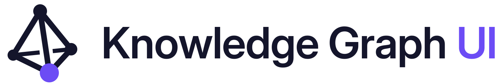
  </picture>
</p>

<p align="center">
  <b>A 3D, kinetic front end for any knowledge graph.</b><br>
  React · TypeScript · Three.js. Drop in a <code>{ nodes, links }</code> JSON file and explore it in motion.
</p>

<p align="center">
  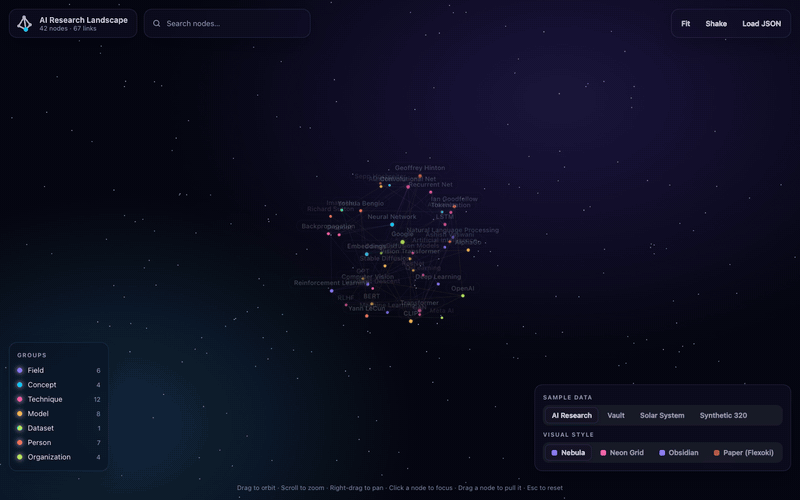
</p>

<p align="center"><a href="docs/media/demo.mp4">▶ Watch the full 30-second demo (MP4)</a></p>

---

## Features

### Kinetic, physical interaction
Nodes behave like a spring mesh. The cursor acts as a soft force field: nodes part around it and get pulled along in its wake. Clicking a node sends a shockwave hop by hop through its neighbours, and dragging a node pulls its connections with it.

<p align="center">
  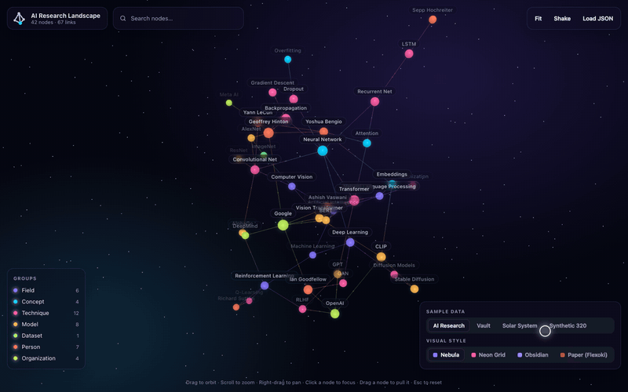
</p>

| Hover to highlight neighbours | Click to focus, with details and relations |
|---|---|
| 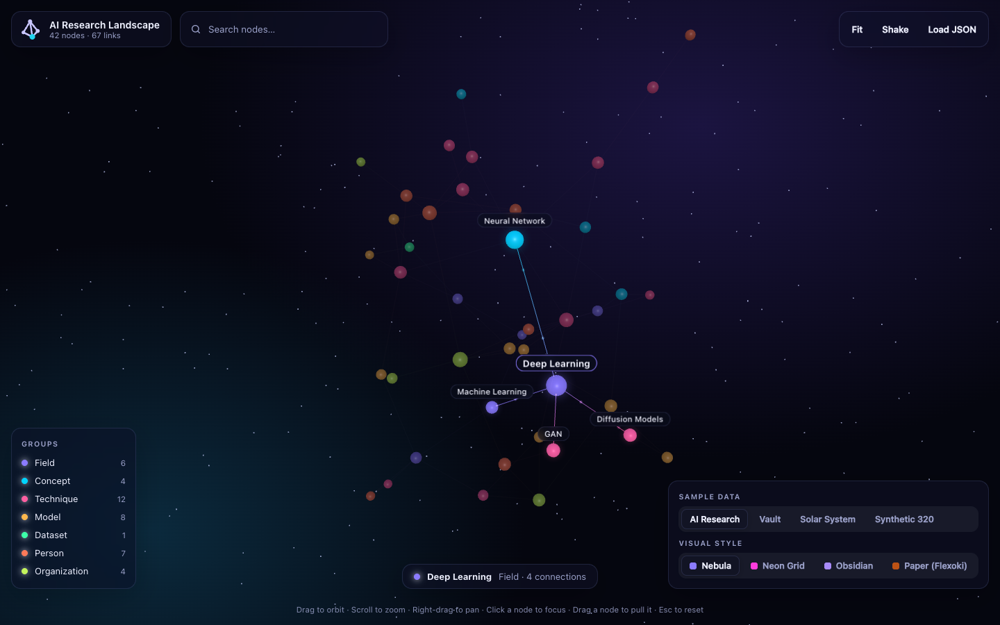 | 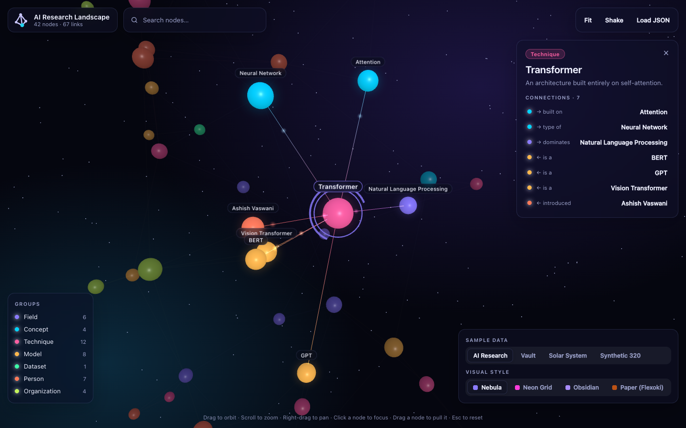 |

### Find anything fast
- **Search** with suggestions, then fly to the result.
- **Group legend**: hover a group to light up all of its nodes.
- **Details panel** with the description, metadata and every relation; click a relation to jump to that node.
- **Labels fade in as you zoom**, so overviews stay clean and close-ups stay readable.

| Search | Group highlight |
|---|---|
| 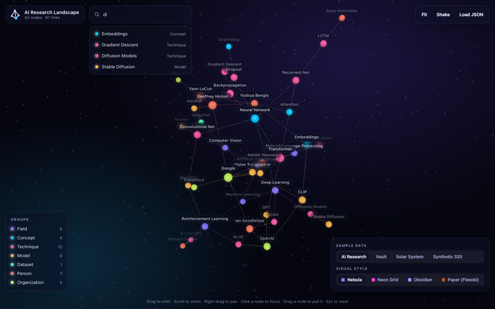 | 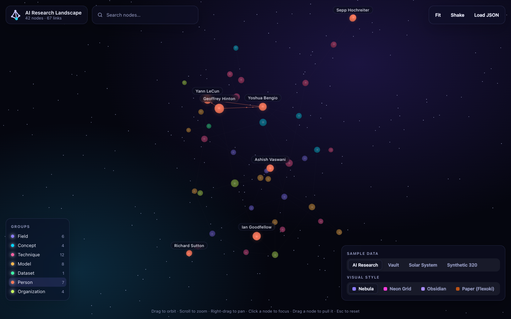 |

### Four visual styles

<p align="center">
  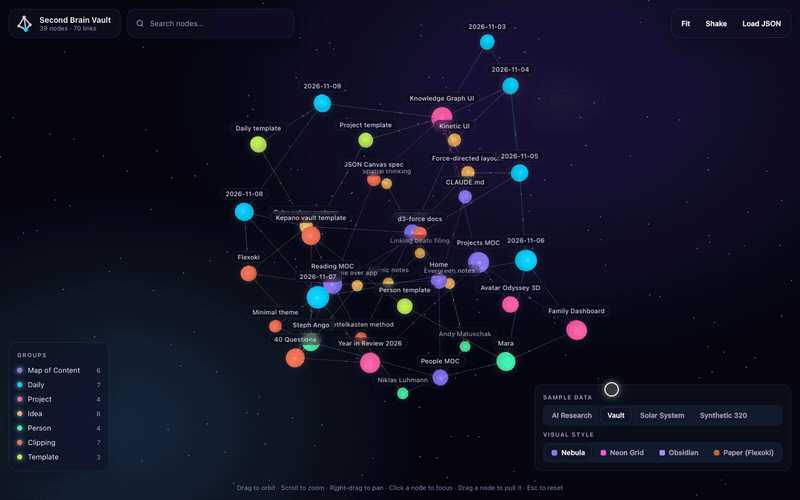
</p>

| Nebula | Neon Grid |
|---|---|
| 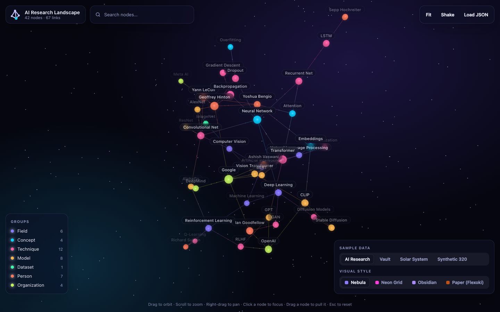 | 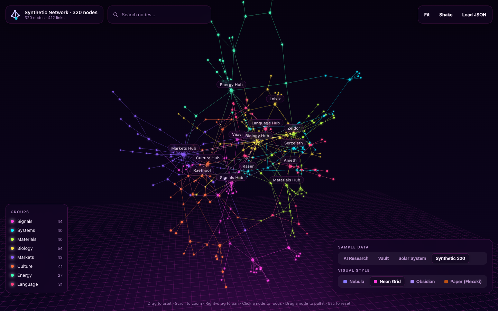 |
| **Obsidian** | **Paper (Flexoki)** |
| 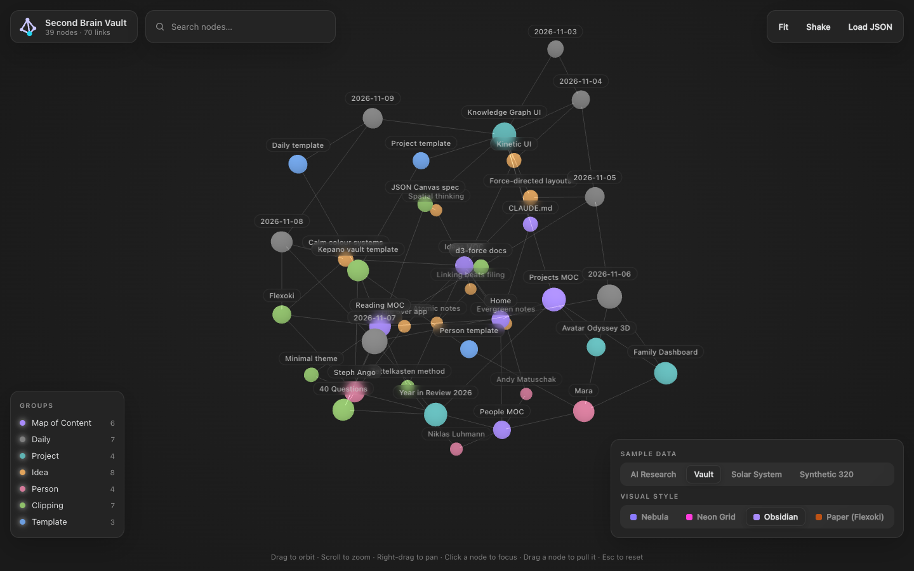 | 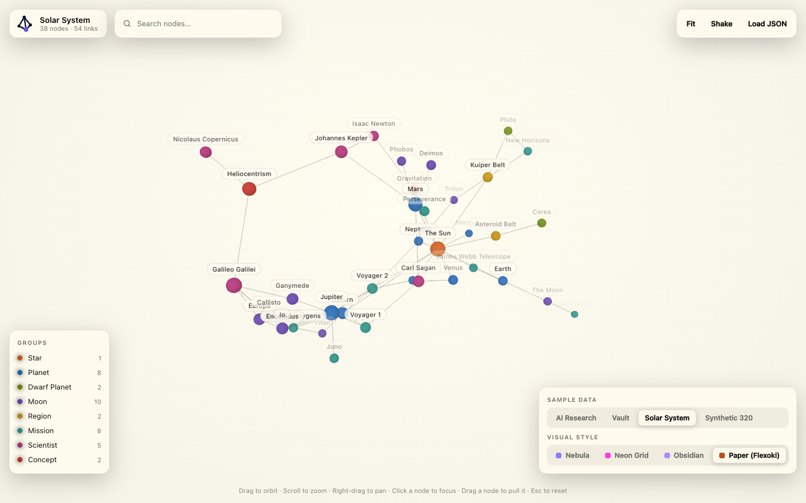 |

- **Nebula**: glowing spheres, a starfield and particles flowing along links.
- **Neon Grid**: spinning faceted nodes, magenta and cyan glow, and a floor grid.
- **Obsidian**: calm and minimal, inspired by Obsidian's graph view.
- **Paper**: a light, ink-on-paper style using Steph Ango's Flexoki colours.

### Works with any graph
Load your own data with the **Load JSON** button, or point the app at a file with a link. It handles up to about 600 nodes smoothly (hard limit 2,000).

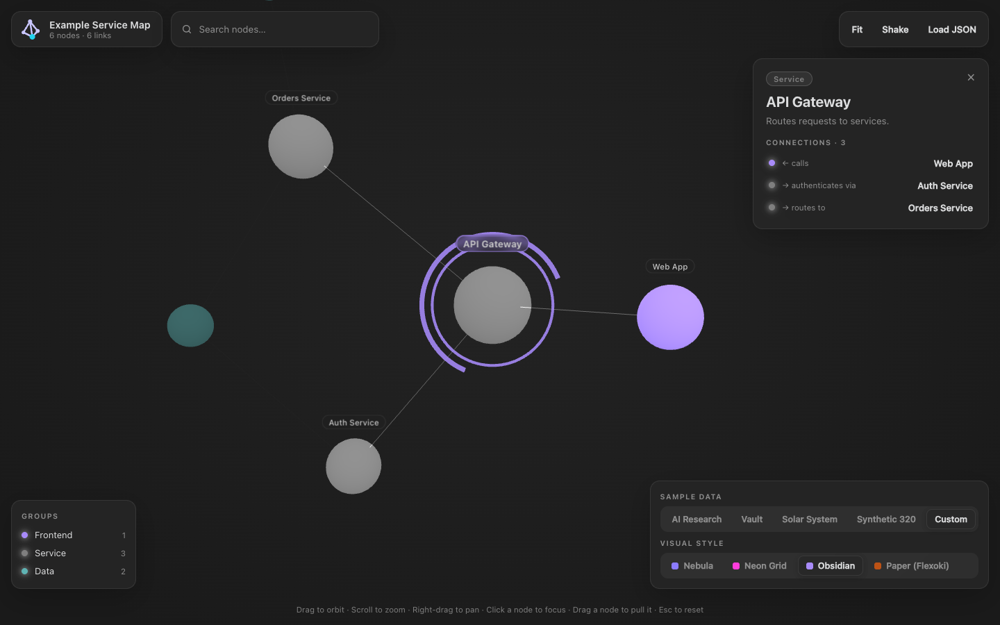

---

## Quick start

Requires Node.js 18 or later.

```bash
git clone https://github.com/albertjayinm/knowledge-graph-ui.git
cd knowledge-graph-ui
npm install
npm run dev        # http://localhost:5173
```

`npm run build` creates a static production build in `dist/`.

## Bring your own data

A graph is a JSON file with `nodes` and `links`:

```json
{
  "title": "Example Service Map",
  "nodes": [
    { "id": "api", "label": "API Gateway", "group": "Service", "description": "Routes requests.", "owner": "platform" },
    { "id": "auth", "label": "Auth Service", "group": "Service" }
  ],
  "links": [
    { "source": "api", "target": "auth", "label": "authenticates via" }
  ]
}
```

| Field | Required | Notes |
|---|---|---|
| `node.id` | yes | Unique string. |
| `node.label` | recommended | Display text (`name` also works). |
| `node.group` | recommended | Sets the colour and legend entry (`type` also works). 8 groups or fewer look best. |
| `node.description` | optional | Shown in the details panel. |
| `node.size`, `node.color` | optional | Override the radius (normally based on the number of connections) or the colour. |
| other node fields | optional | Strings, numbers and booleans are listed in the details panel. |
| `link.source`, `link.target` | yes | Node ids (`from`/`to` and an `edges` array also work). |
| `link.label` | recommended | The relation, e.g. "calls" or "depends on". |

A full example is in [`public/graphs/example.json`](public/graphs/example.json).

### Open a graph with a link

Put a file in `public/graphs/` and open it by URL:

```
http://localhost:5173/?src=/graphs/example.json&theme=obsidian&focus=api
```

| Parameter | Values | Effect |
|---|---|---|
| `src` | relative or http(s) URL | Graph JSON to load. |
| `theme` | `nebula`, `neon`, `obsidian`, `paper` | Visual style. |
| `focus` | node id | Flies to and selects that node once the layout settles. |
| `sample` | `ai`, `vault`, `space`, `synthetic` | Built-in sample (ignored when `src` is set). |
| `capture` | `1` | Frame-by-frame mode for recordings (see below). |

## Controls

| Action | Effect |
|---|---|
| Drag | Orbit |
| Scroll | Zoom toward the cursor |
| Right-drag | Pan |
| Move the cursor | Nodes part around it |
| Click a node | Focus: ripple, shockwave, camera flight, details panel |
| Drag a node | Pull it; its neighbours follow |
| `Esc` | Clear the selection |

The view slowly auto-rotates after 5 seconds without input.

## Use it as a React component

```tsx
import { useRef } from 'react';
import { KnowledgeGraph, type KnowledgeGraphHandle } from './components/KnowledgeGraph';
import { THEMES } from './graph/themes';

export function Explorer({ data }) {
  const graph = useRef<KnowledgeGraphHandle>(null);
  return (
    <KnowledgeGraph
      ref={graph}
      data={data}                         // { nodes, links }
      theme={THEMES[0]}
      focusId="api"                       // optional: select once the layout settles
      onSelect={(node) => console.log(node)}
      onHover={(node) => {}}
    />
  );
}
// graph.current?.focusNode(id) · fitView() · reheat() · clearSelection() · highlightGroup(group | null)
```

The 3D engine ([`src/graph/GraphEngine.ts`](src/graph/GraphEngine.ts)) is framework-free, so the React wrapper is thin.

## Use it from a coding agent

The repo ships an agent skill at [`.github/skills/knowledge-graph-ui/`](.github/skills/knowledge-graph-ui/SKILL.md). Ask your agent to "visualize the import graph of `src/`" or "map these notes as a graph", and it will:

1. Turn the data into `{ nodes, links }` JSON.
2. Check it with `scripts/validate-graph.mjs` (duplicate ids, links to missing nodes, too many groups or nodes).
3. Open it with `?src=…` and report the link.

GitHub Copilot picks the skill up automatically inside this repo. To use it in any project, copy the folder to `~/.copilot/skills/` (Copilot) or `~/.claude/skills/` (Claude Code).

## How it works

- **Layout**: a custom 3D force simulation ([`ForceLayout.ts`](src/graph/ForceLayout.ts)) with charge, link and gravity forces that cool down. Once settled, nodes are held by springs to their resting positions, which produces the elastic response to the cursor, clicks and drags.
- **Rendering**: instanced meshes for nodes, custom shaders for glow halos, links and flowing particles, and fog that adapts to the zoom level. One draw call per layer keeps a few hundred nodes at 60 fps.
- **Labels**: HTML overlays positioned each frame; they fade in by importance and zoom.

```
src/
  graph/         GraphEngine.ts (Three.js) · ForceLayout.ts · themes.ts · types.ts
  components/    KnowledgeGraph.tsx (React wrapper)
  data/          samples.ts (built-in samples + JSON parser)
  App.tsx        UI shell: search, legend, details panel, sample/style switcher
brand/           logo kit (SVG masters, exports, guidelines, generators)
public/graphs/   graphs you can open with ?src=
```

## Recording demos

`?capture=1` stops the real-time clock and exposes `window.__kgAdvance(frames)`, which advances exactly one 1/30 s frame per step. A browser-automation script can then call it and take a screenshot after each frame, giving smooth recordings even on slow or headless machines. The GIFs above were made this way.

## Brand

The logo is a four-node pyramid graph whose back link breaks where it passes behind the front one, so it reads in 3D. The coloured front node is the node in focus. The full kit (symbol, lockups, favicon, app icons and usage guide) is in [`brand/`](brand/GUIDELINES.md).
